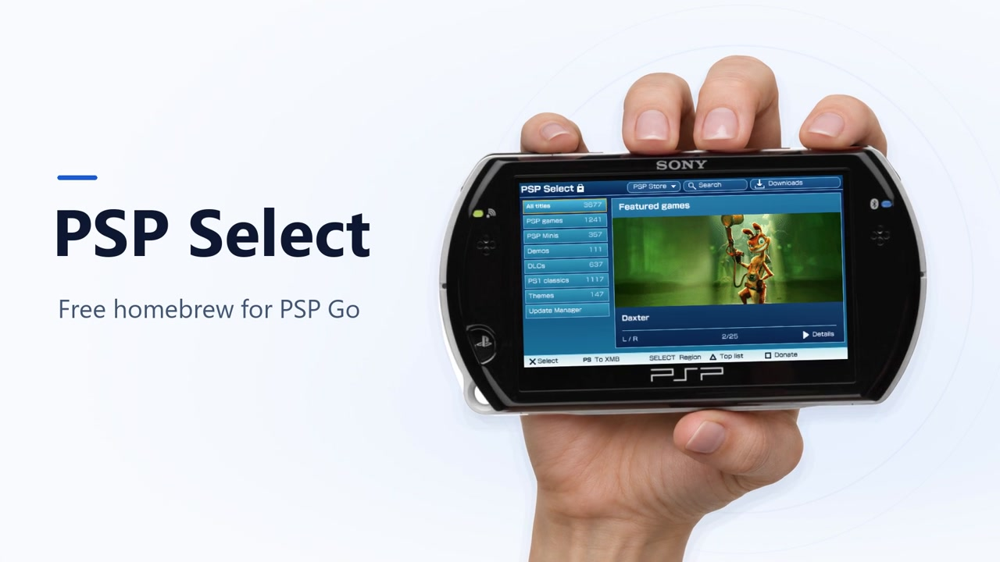
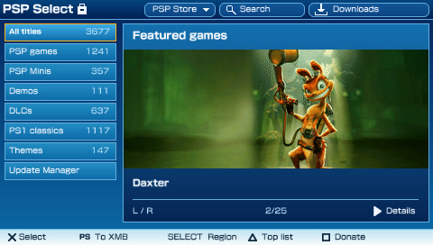
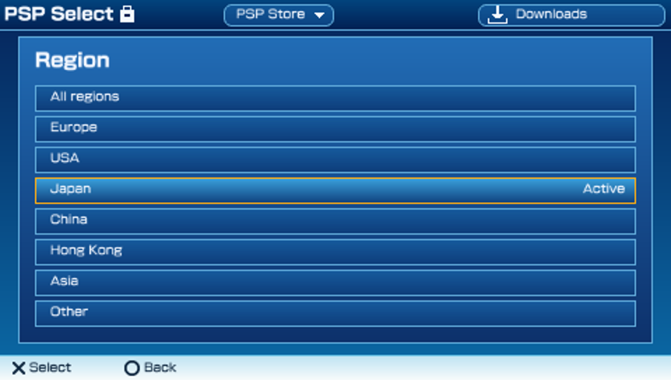
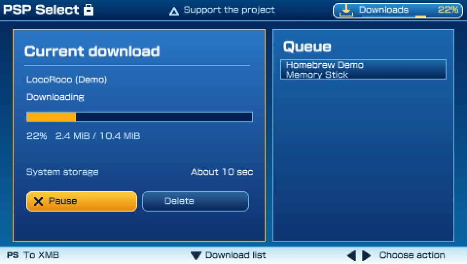
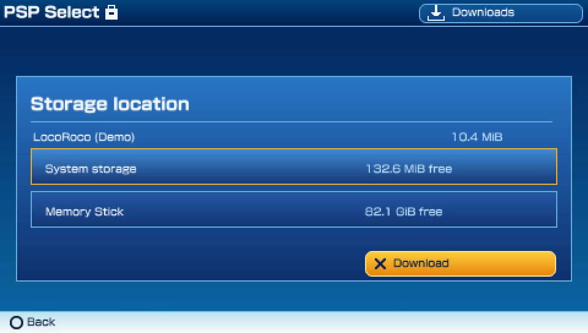
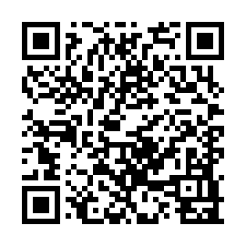

# PSP Select



<p align="center"><strong>A fresh store experience for your PSP Go.</strong><br>Free homebrew. Available directly in the XMB.</p>

<p align="center"><a href="https://github.com/PSPSelect/psp-select/releases/latest/download/PSP-Select-Setup.zip"><strong>Download PSP Select</strong></a> · <a href="https://github.com/PSPSelect/psp-select/releases/latest">Latest release &amp; notes</a> · <a href="#installation">Installation</a></p>

**Requires a PSP Go running 6.61 ARK-5, installed separately.**

PSP Select adds its own entry directly below **PlayStation Store** in the XMB. Browse the catalog over Wi-Fi, discover titles by category or region, and manage downloads and installation from one place.

## A closer look

| Discover the catalog | Choose your region |
| --- | --- |
|  |  |
| Browse categories, search for a title, or explore curated top titles. | Filter the catalog by Europe, USA, Japan and more. Your region choice is remembered. |

| Follow your downloads | Choose where to save |
| --- | --- |
|  |  |
| Queue downloads, check progress and estimated time remaining, pause or resume, and follow verification and installation. | Select **System Storage** or **Memory Stick** for each download. The installer also lets you choose where the Store is installed. |

*Store interface previews. Download progress and transfer times are illustrative.*

## Made for everyday use

- **An entry in the XMB.** Open PSP Select from PlayStation Network; the original PlayStation Store entry remains available.
- **12 interface languages.** The Store and installer follow your PSP's system language.
- **A catalog you can explore.** Categories, search, region filters, cover previews and curated top titles help you find a title.
- **A clear Download Manager.** See queued jobs, progress, estimated time remaining, verification and installation status.
- **Storage is your choice.** Install the Store on System Storage or Memory Stick, then choose destinations for individual downloads.

**Downloads pause when you leave PSP Select.** Reopen the Store and connect to Wi-Fi to resume from the saved position. Downloads do not continue in the XMB in this release.

## Installation

1. Make sure your **PSP Go already runs 6.61 ARK-5**. This download does not install custom firmware.
2. Download **[PSP-Select-Setup.zip](https://github.com/PSPSelect/psp-select/releases/latest/download/PSP-Select-Setup.zip)** and extract it on your computer.
3. Connect your PSP by USB. Copy the extracted **PSP** folder to the root of System Storage or Memory Stick. Keep the three files together:

   ```text
   PSP/
   └── GAME/
       └── PSPSELECT_SETUP/
           ├── EBOOT.PBP
           ├── STORE.DAT
           └── LICENSES.txt
   ```

4. Safely disconnect USB. Under **Game**, launch **PSP Select Setup**, choose **System Storage** or **Memory Stick**, and confirm installation. The PSP restarts automatically when setup finishes.
5. In the XMB, go to **PlayStation Network** and open **PSP Select**, immediately below **PlayStation Store**. Select your Wi-Fi connection when prompted.

If you install the Store on Memory Stick, keep that card inserted when starting the PSP. You can still choose a different destination for individual downloads.

## Questions

### Does PSP Select replace the original Store?

No. Select the separate **PSP Select** entry below PlayStation Store. The Sony entry stays in place.

### Do I need a local server?

No local server is required for this release. After setup, the catalog and downloads are accessed from the PSP over Wi-Fi.

### Are games included in the ZIP?

No. The installer includes the Store, catalog data, cover previews and language files. Sony firmware and games are not bundled. Only download content you are entitled to use.

### How do I remove the Store?

Open **PSP Select Setup** again, press **Triangle**, and confirm removal. The PSP restarts automatically. Downloaded games and saved data are kept.

### Where can I report a problem?

[Open an issue](https://github.com/PSPSelect/psp-select/issues/new) with your PSP model, ARK version and the steps that led to the problem.

---

PSP Select is an independent homebrew project and is not affiliated with Sony. PSP, PlayStation and referenced game names and artwork belong to their respective owners. Third-party license notices accompany the installer in `LICENSES.txt`.

## Support PSP Select

PSP Select is free to use. If you enjoy it, a voluntary Bitcoin donation helps support development, testing and future improvements. Every contribution is appreciated. Thank you for helping keep PSP homebrew alive.

**Bitcoin (BTC — Bitcoin network)**

`bc1qv44zpvua32x3g4ejaphrskt60qsmwyjvrxh3fw`


